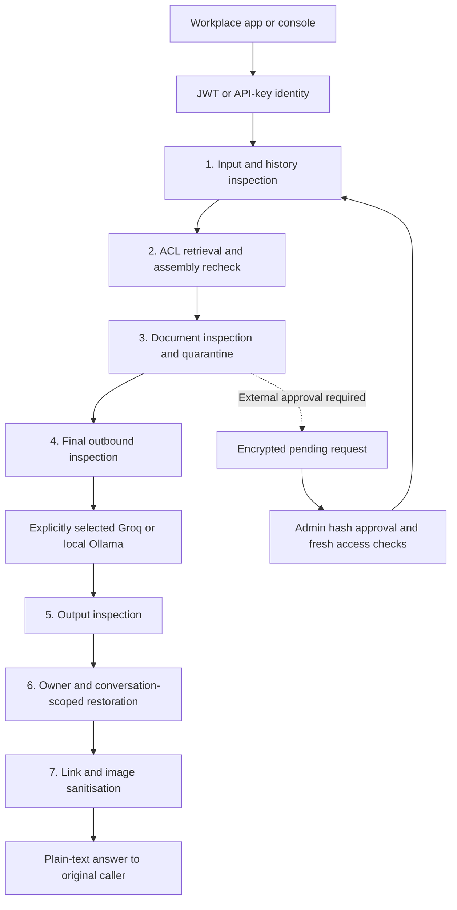
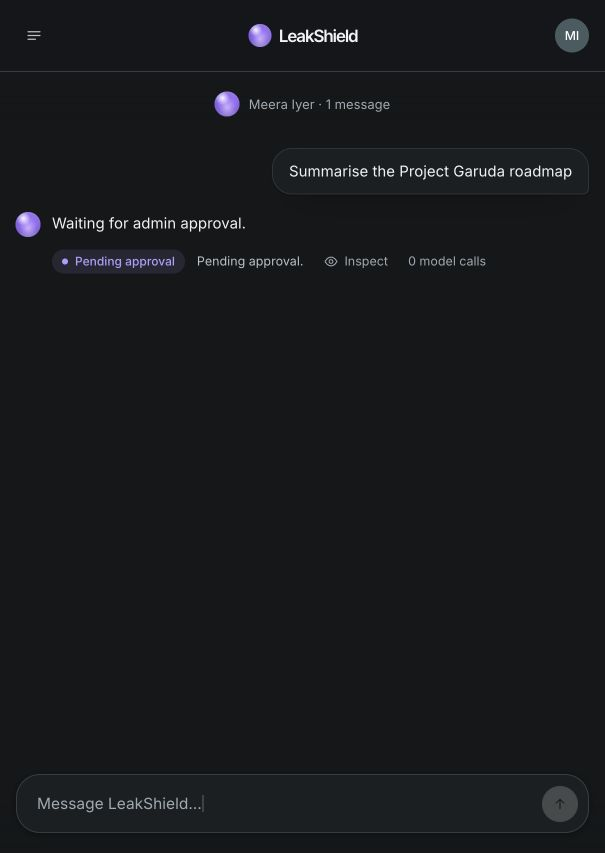
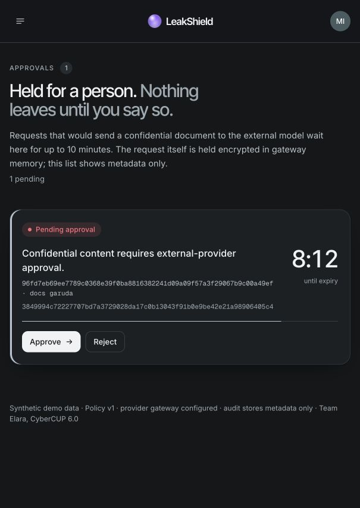
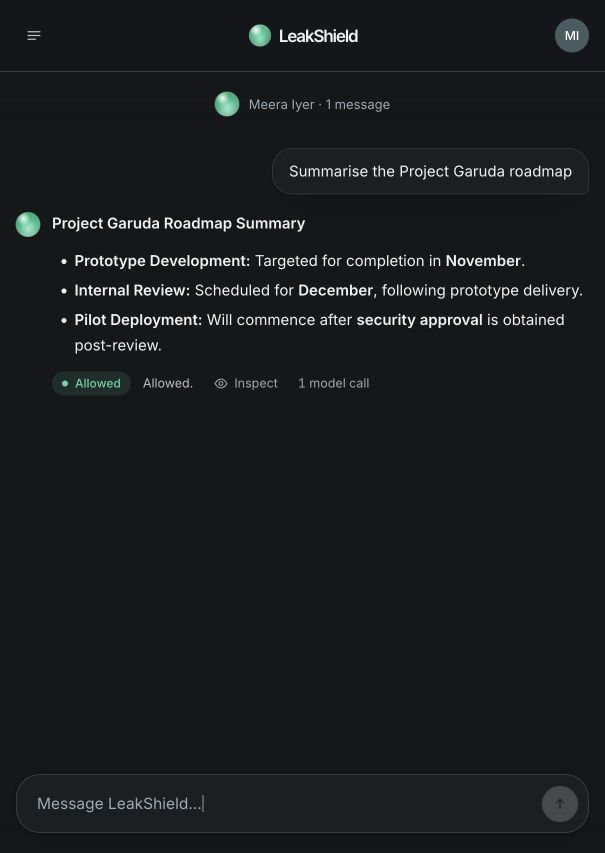

# Aevia AI / LeakShield

LeakShield inspects sensitive input and document access before workplace apps call an LLM.<br>
It combines masking, ACL retrieval, quarantine, approval replay and output checks to support permitted work.<br>
CyberCUP 6.0 · CC6-AI03 · synthetic demo and evaluation data; documented limitations apply.

**Frozen v2 headline: 12 → 1 provider-leak flags on the same 60 cases**, with **53/60 exact actions** and **56/60 robustness exact actions**, using real Groq `gpt-oss-20b`. One IFSC provider flag remains; this is not a zero-leakage claim. [Results, v1/v2 provenance and timing scope](results/freeze-v2-groq/RESULTS.md) · [Limitations and known misses](docs/LIMITATIONS.md).

**Team:** Arihant — console/evaluator; Mahatva — gateway/provider lifecycle; Ojaswi — detectors/analysis; Alwaz — access/approvals/deck. [Team assignments](docs/TEAM.md) · [Console API](docs/API.md) · [Real-provider and deployment checks](docs/MAHATVA_FINAL.md).

## Architecture



The direct path continues only when policy permits it; a required approval pauses before any external call and replays the full pipeline after approval. Denied or quarantined content is withheld. Mongo stores metadata-only audit/approval records; sensitive conversation and pending-request state stays in process memory. In the checked Personal organization, inference ZDR is **disabled**: approved content can reach Groq, and we do not claim zero retention. [Account scope and judge wording](docs/GROQ-ACCOUNT-CHECK.md).

## Current console

Actual Halo UI after the ReDoS hotfix and UI merge, captured on main `0c560db` with synthetic records and real Groq **gpt-oss-120b**. This browser smoke check is separate from the frozen **20b** evaluation above. Meera's Garuda request waits with zero calls, an admin approves it in Approvals, then the original conversation completes with one call. [Reproduce the scene](docs/DEMO.md#actual-console-check-after-hotfix-and-halo-ui-merge) · [Verification and remaining human rehearsal](docs/ALWAZ-FINAL-UI.md).

| Pending: no provider call | Admin approval queue | Returned answer: one call |
| --- | --- | --- |
|  |  |  |

## What works

- JWT/API-key identity; opt-in passwordless login for the five synthetic demo accounts.
- YAML policy validation and reload, with version checks and fail-closed invalid changes.
- Exact random pseudonyms in a memory-only conversation vault, isolated by owner and conversation, with a 30-minute TTL.
- Input/history inspection, last-three-user-message secret checks, ACL rechecks on retrieved chunks, whole-document quarantine and final assembled-payload inspection.
- One buffered HTTP adapter for Groq and local Ollama, with attempt counters, bounded 429 retries, response-size limits and a shared timeout budget.
- Buffered output inspection, canary detection, optional restricted-overlap checking, exact restoration, then link/image sanitisation.
- Metadata-only Mongo audit records, HMAC identities, a 30-day TTL index and authenticated SSE incidents.
- Console chat APIs, advisory `/v1/scan`, and text-only `/v1/chat/completions`, including **buffered** SSE compatibility.

The production adapter uses `safeDetectAll`, `detectResponse`, `detectSplitSecrets` and `findLinks`. Missing or failed scanners stop processing. The approval bridge re-enters the full pipeline after admin approval; revoked permissions, changed policy/content, hash mismatch and repeat approval cannot authorise a provider call. Results are available once to the original user/conversation. [Classifier decision and measured limits](docs/CLASSIFIER-GATEWAY.md).

## Local setup

Use Node **24 LTS** (also supported: Node 22.12+ or 26+), npm, and MongoDB. Run commands from the repository root.

```sh
npm ci
npm run setup:env
```

Start your MongoDB service before seeding. If `mongod` is installed but no service is running, this macOS/Linux example starts a local instance in a separate terminal:

```sh
mkdir -p .cache/mongodb/data
mongod --dbpath .cache/mongodb/data --bind_ip 127.0.0.1 --port 27017
```

Keep that terminal open. An existing local Mongo service is also suitable; do not start a second server on its occupied port. On Windows use the installed MongoDB service or run the same `mongod` options with an existing writable data directory. MongoDB installation is a prerequisite, not something `npm ci` installs for the normal gateway.

Edit the generated `.env` locally:

1. For Groq, set `GROQ_API_KEY` and an available `GROQ_MODEL` from the team's account. For local inference, set `LLM_PROVIDER=ollama` and `OLLAMA_MODEL` to a model already pulled on that machine. The gateway never silently falls back to another destination.
2. Set `MONGODB_URI` for your MongoDB instance; the default is local Mongo on port 27017. Set `MONGODB_DB` to a dedicated synthetic-demo database, for example `leakshield_demo`; the gateway and seed must use the same database and generated `FINGERPRINT_KEY`.
3. The detector module is included at `packages/detectors/src/index.ts`. `CLASSIFIER_BACKEND=none` uses its rules; optional `node` loads the pinned fp32 classifier. Int8 is not enabled because the recorded attack predictions failed.
4. For the **local synthetic demo only**, set `DEMO_AUTH=true` to enable the console's user switcher. This endpoint issues privileged demo identities without passwords; keep it disabled outside an isolated demo.
5. The sample config sets `RETRIEVAL_MODULE=apps/gateway/src/retrieval/index.js` and `APPROVALS_MODULE=apps/gateway/src/approvals/index.js`. Existing `.env` files should use these paths too. Both modules and the bridge are now included. With Mongo running, seed the dedicated synthetic demo database using `npm run seed`; it uses the same `MONGODB_URI`, `MONGODB_DB` and `FINGERPRINT_KEY` as the gateway. Do not seed a production database.
6. For the isolated synthetic rehearsal in [DEMO.md](docs/DEMO.md), set `EVAL_MODE=1` locally; the generated config otherwise defaults to `false`. Keep `HOST=127.0.0.1` and `BASELINE_MODE=false`. Do not use these evaluation settings for a public deployment.

Once Mongo is reachable and `.env` is configured, seed before starting the gateway:

```sh
npm run seed
```

The synthetic seed reports 10 documents, 10 chunks and 2 quarantined sources. A connection error here usually means Mongo is not running or `MONGODB_URI` points to a different port. Do not regenerate the fingerprint key between seed and gateway startup.

```sh
npm run dev
```

The gateway listens on `http://127.0.0.1:8080`, matching the console's existing proxy. In a second terminal:

```sh
npm run dev --workspace @leakshield/web
```

Open `http://localhost:5173`. Set the web app's `VITE_API_MODE=live` for rehearsals so a missing gateway cannot be mistaken for a real result. The UI's mock mode is a separate frontend feature, not evidence of gateway operation.

Set frontend mode in the console process, not just the repository-root `.env`. For example, on macOS/Linux use `VITE_API_MODE=live npm run dev --workspace @leakshield/web -- --strictPort`. In PowerShell, set `$env:VITE_API_MODE='live'` before the console command. The default gateway/console ports are 8080/5173; check that they are free before starting. A stale service can otherwise be mistaken for the new checkout, and Vite may silently choose another port without `--strictPort`. If intentionally changing ports, match the console's `GATEWAY_URL` to the gateway and the gateway's `CORS_ORIGIN` to the actual console origin, then restart both processes.

See [the latest independent clean-clone setup check](docs/ALWAZ-CLEAN-CLONE.md): the normal seed, gateway and web/proxy startup passed with persistent MongoDB and real Groq. The [post-merge browser check](docs/ALWAZ-FINAL-UI.md) now also passes; the timed joint team rehearsal remains a separate human task.

For a rehearsal without a cloud key or an installed Mongo server, use `npm run demo:gateway` instead of `npm run dev`, then start the console in its default auto mode. This starts the complete gateway with a temporary real MongoDB and an explicitly simulated loopback HTTP provider; the console displays **simulated provider**. This tests integration, not real model behavior or quality. The first run downloads MongoDB. Keep it separate from the normal gateway because both use port 8080.

For JWT-only use, leave demo login disabled and run `npm run token -- asha`. Tokens expire after one hour and exist only in terminal/session memory. API keys are mapped to identities through `API_KEYS_JSON`; prompts never grant permissions. Only when `DEMO_AUTH=true` and no real API keys are configured, `ls_demo_asha` is enabled for the existing SDK demo; it is not a production credential.

## Container setup

After configuring `.env` and merging the teammate modules:

```sh
docker compose up --build
```

Mongo and the gateway bind to loopback on the host. The gateway runs as the unprivileged `node` user. Container evaluation capture is disabled. Ollama can run separately on the host and is accessed through `host.docker.internal`; pull the selected model there first. The console currently runs using its existing Vite command above; a web production image belongs to its owner.

Docker/WSL are not installed on the Windows development host. Actual container build/start and local-model inference passed on a clean GitHub Ubuntu runner; actual native Windows Ollama inference passed separately. See the final checks above. Simulated integration tests remain distinct from these real model measurements.

## API

- `GET /api/health`, `GET /health`: liveness.
- `GET /ready`: scanner/policy readiness at startup; audit failures independently stop requests.
- `POST /api/auth/login`: opt-in synthetic demo login.
- `POST /api/chat`: existing console contract, with `message` and nullable `conversation_id`.
- `GET /api/approvals`, `POST /api/approvals/:id/approve|reject`: admin metadata and decisions; `GET /api/access/results/:requestId?conversation_id=...` returns the approved result to its original owner once.
- `POST /chat`: programmatic contract, with `prompt` and optional `conversation_id`/`approval_id`.
- `POST /v1/scan`: advisory preflight `{ "text": "...", "history": [] }`; returns summaries, masked text and a temporary caller-only vault, writes metadata audit and never calls a provider.
- `GET /api/events` or `/events`: admin-only SSE. Use authenticated `fetch`; native `EventSource` cannot add an Authorization header.
- `GET /api/stats?window=60`: admin-only completed-request statistics, category/action counts, five-minute buckets and overhead percentiles excluding model time. Windows are bounded to 5–1440 minutes.
- `GET /policy`: admin-only policy snapshot. Edit and increment the version in `apps/gateway/policy.yaml` to reload.
- `POST /v1/chat/completions`: use model alias `leakshield` (or the configured provider model); supported fields are `model`, string-content `messages`, `stream`, and `n: 1`. Decisions are returned in `leakshield`; policy-blocked requests return a safe completion with HTTP 200 and zero provider calls, including buffered streaming. Unsupported fields are rejected. Client system text remains untrusted context; the gateway owns the privileged system instructions.

Both chat routes return final **plain text**. Never render answers with `innerHTML` or permit automatic remote image fetching. The existing console renders safe formatting without raw HTML, executable links or fetched images. `/v1` callers must enforce the same rule.

The ordinary console response contains only the sanitised current user turn in `sent_to_model`. Full `captured_payload` on `/chat`, or `eval.provider_payload` on `/api/chat` with `X-Eval-Capture: 1`, is available only with `EVAL_MODE=true` (or `1`) on loopback. It contains permitted model context and private test markers. Consume it in memory, calculate leak booleans, and discard it. Never log or commit it.

For the **unprotected comparison only**, start a separate local evaluation process with `HOST=127.0.0.1`, `EVAL_MODE=1`, `BASELINE_MODE=true` and synthetic seeded data. Then Arihant's existing `eval/run.mjs --baseline` header is supported. This deliberately omits ACL filtering, masking, quarantine and output checks, using the same provider; raw multi-turn history is encrypted in memory. Ordinary gateway instances reject that header explicitly. Baseline mode cannot start on a public bind address or in Compose. Keep it off for the actual demo and never use real records in this process.

## Verification

```sh
npm run typecheck
npm test
npm run test:integration
npm audit
npm run typecheck:access
npm run eval:validate
```

Unit tests inject a deterministic fixture detector/provider. Integration tests use **real MongoDB**, the real HTTP provider adapter, and the stock OpenAI client, against a **simulated LLM HTTP server**. The first Mongo integration run may download a large MongoDB binary into a local cache. Detector hand-off tests run when the production detector module exists; otherwise they are explicitly skipped. `TEST_DETECTOR_MODULE` can point to a checkout of Ojaswi's branch without merging or editing it.

Ojaswi's detector branch and Alwaz's access branch are included with their authorship preserved. The existing evaluator was run end to end on Mahatva's **dev cases only**, in protected and baseline modes with a simulated model HTTP server; generated reports remained temporary. Root datasets now contain **20 dev, 60 held-out, 60 robustness and 10 live-subset cases**. No held-out cases were run for detector tuning. Existing access-package tests exercise their authored held-out/robustness copies; they are not independent frozen evaluation evidence. Mahatva's contribution copies remain under `eval/contributions/mahatva/`.

## Limits

This is a single-process hackathon gateway: restart discards conversations and pending in-memory state; horizontal scaling needs shared secure session storage. Scanner timeouts cannot interrupt synchronous code that blocks Node's event loop, so detector implementations must bound their computation. Canaries/fingerprints are extra checks, not proof against paraphrased leaks. Document-derived PII is irreversibly redacted. Frozen real-Groq results retain an IFSC policy mismatch, false positives and Hinglish misses; do not claim zero leakage or universal accuracy. LLM generation in automated integration tests is simulated; separate actual-provider evidence is linked above.

## Current frozen evidence and team handoff

The integrated decision code is tagged [eval-freeze-v2](https://github.com/TeamElara/Aevia-AI/tree/eval-freeze-v2), created 15 October 2026 at 17:02:11 IST. Use npm and the root package-lock. CLASSIFIER_BACKEND stays none.

- [Real Groq held-out, baseline and robustness results](results/freeze-v2-groq/RESULTS.md)
- [Eight-slide editable team deck](docs/LeakShield-Freeze-v2.pptx)
- [Freeze time and reproduction commands](docs/EVAL-FREEZE-V2.md)
- [Limitations and known misses](docs/LIMITATIONS.md)
- [Canonical Arihant/Ojaswi script, checklist and Garuda verification](docs/DEMO.md)
- [Groq model, recorded limits and disabled ZDR in the checked account](docs/GROQ-ACCOUNT-CHECK.md)

The v2 protected run has 1 provider-leak flag versus 12 baseline flags, not zero. Historical reports and deck revisions remain in Git history; use only the linked canonical team deck. Follow the per-report provenance when presenting numbers.
